# Phase Zero and Minutes Desk – documentation

This repository started as **Select or Die**, a jQuery plugin from 2014 that styles `<select>` elements. It
lives in `_src/`, `_themes/` and `_demo/` and is unchanged. In October 2026 two local-first tools for project
managers in a PMO were added beside it:

| Folder | What it is | Built with | Tests |
|---|---|---|---|
| [`phase-zero/`](../phase-zero/README.md) | Business-analysis and PMO workspace. A business goal becomes a charter, user stories, a plan, a RAID log, weekly-report and release-notes drafts, all with version control, skill-based reviews and stage gates. | Node 22 (no runtime dependencies), React + Vite | 30 |
| [`minutes-desk/`](../minutes-desk/README.md) | Recordings-to-minutes for Arabic and English meetings. Video, audio, Teams transcripts, WhatsApp exports or notes become minutes for committees and stakeholders. | Python 3.10+ (standard-library server), plain JavaScript page, optional Whisper models | 30 |

Both tools run **on your own computer**, bind to `127.0.0.1`, and keep organisation content in a git-ignored
`workspace/` folder. The repository is public, so it holds code and invented sample data only.

- [1. The whole picture](#1-the-whole-picture)
- [2. Phase Zero](#2-phase-zero)
- [3. Minutes Desk](#3-minutes-desk)
- [4. Skills: how the PMO rules are built into the code](#4-skills-how-the-pmo-rules-are-built-into-the-code)
- [5. Privacy and security model](#5-privacy-and-security-model)
- [6. Quality: tests, measurements and checks](#6-quality-tests-measurements-and-checks)
- [7. Change log](#7-change-log)

---

## 1. The whole picture

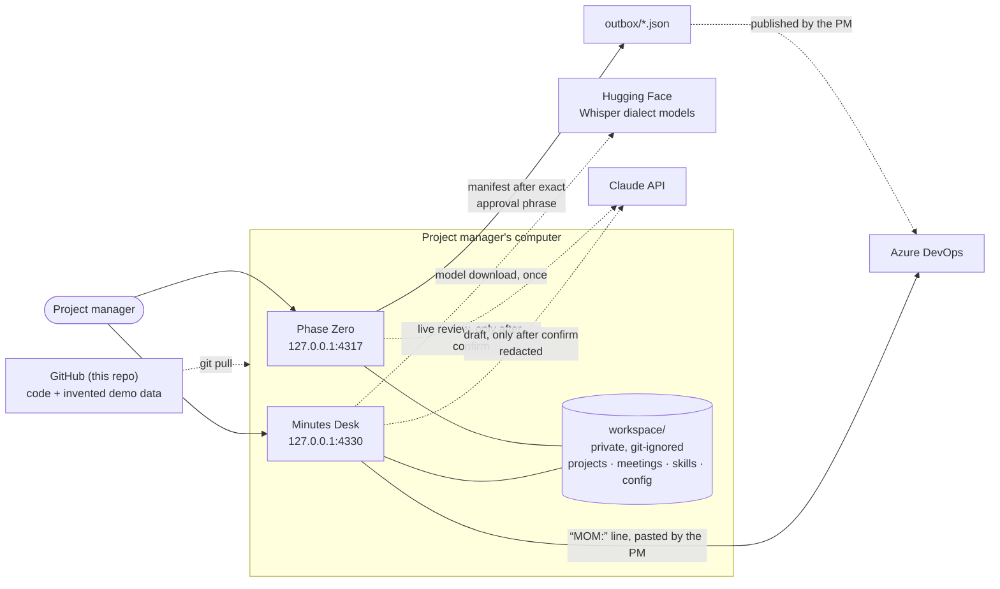

Dotted lines are optional or manual. Nothing leaves the computer without a person acting. **Neither tool writes
to Azure DevOps by itself.**

### Quick start

```bash
# Phase Zero
cd phase-zero && npm install && npm run build && npm start      # http://127.0.0.1:4317

# Minutes Desk (Windows: scripts\install-windows.bat, then scripts\start-windows.bat)
cd minutes-desk && scripts/install.sh && scripts/start.sh         # http://127.0.0.1:4330
```

---

## 2. Phase Zero

### 2.1 What a project manager does with it

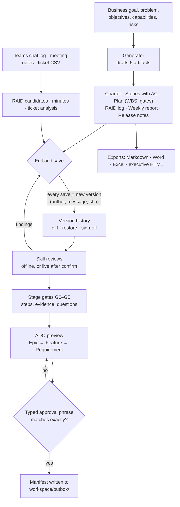

### 2.2 Architecture

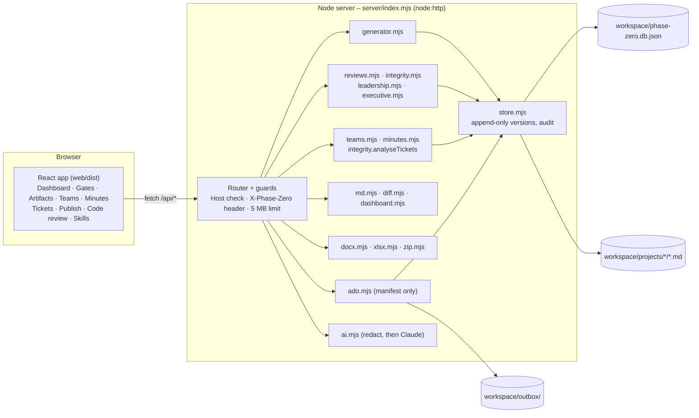

| Module | Responsibility |
|---|---|
| `server/index.mjs` | Routes, security guards, seeding projects from `workspace/projects/` and `demo/`, static files |
| `lib/store.mjs` | JSON store: projects, artifacts, append-only versions with sha, sign-offs, reviews, gates, approvals, audit |
| `lib/generator.mjs` | Business goal → six draft artifacts; anything not given is "not set" / "TBC – requires assignment" |
| `lib/md.mjs` | Front matter, tables and story parsing (`## EP` / `### FE` / `#### US`) |
| `lib/diff.mjs` | Line diff (LCS) between any two versions |
| `lib/reviews.mjs` | Offline reviewers: INVEST + DoR, Use Case Points, NFR coverage, solution value, charter, RAID discipline, weekly structure, rollout, report integrity, diagnostic standard, KPI reply, executive page, minutes naming; code review of the tool's own source |
| `lib/integrity.mjs` | KPI-feedback rule, "baseline" rule, evidence rule, diagnostic blocks, 5-point rule, ticket-export analyser |
| `lib/leadership.mjs`, `lib/executive.mjs` | KPI reply (Table A/B) and executive per-team page (inline SVG) |
| `lib/teams.mjs`, `lib/minutes.mjs` | Teams chat log → RAID candidates; raw notes → minutes |
| `lib/dashboard.mjs` | Decisions required, actions due in 7 days, indicators, charts – all computed from artifacts |
| `lib/docx.mjs`, `lib/xlsx.mjs`, `lib/zip.mjs` | Word and Excel exports written by hand (no library) |
| `lib/ado.mjs` | Validates the target area path and builds the Epic → Feature → Requirement manifest (no tags) |
| `lib/ai.mjs` | Optional live review with Claude: redaction, confirmation required |
| `lib/skills.mjs` | Skills checklist: purpose, benefits, boundaries, where coded |

### 2.3 Version control of an artifact

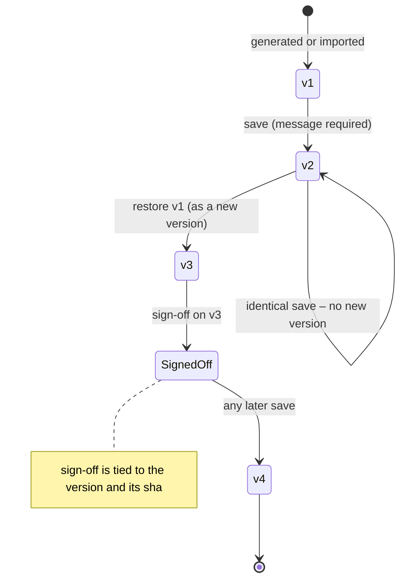

### 2.4 The Azure DevOps gate

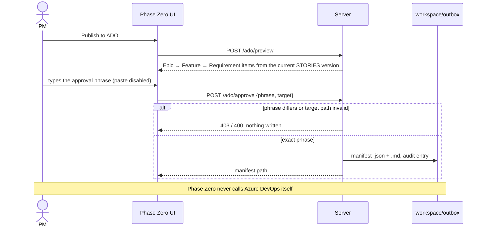

### 2.5 API

| Method | Path | Purpose |
|---|---|---|
| GET | `/api/status` | Version, live-AI availability, workspace |
| GET, POST | `/api/projects` | List or create a project from a business goal |
| GET | `/api/projects/:id`, `/dashboard`, `/audit` | Project, computed dashboard, audit trail |
| POST | `/api/projects/:id/gates/:gate` | Record a gate decision |
| GET, PUT | `/api/artifacts/:id` | Read, or save a new version (message required) |
| GET | `/api/artifacts/:id/versions/:n`, `/diff` | A version, a diff between two versions |
| POST | `/api/artifacts/:id/restore`, `/signoff`, `/review` | Restore, sign off, run a review (live needs `confirm`) |
| GET | `/api/artifacts/:id/export?format=md\|docx\|xlsx\|html` | Exports |
| POST | `/api/projects/:id/ado/preview`, `/ado/approve` | ADO gate |
| POST | `/api/projects/:id/teams`, `/minutes`, `/artifacts` | Chat-log candidates, minutes, new KPI-reply or executive artifact |
| POST | `/api/tickets/analyse`, `/api/integrity/five-point`, `/api/code-review` | Ticket CSV analysis, 5-point rule, code review |
| GET | `/api/skills` | Skills checklist |

All writes need the header `X-Phase-Zero: 1`.

### 2.6 Screens (invented sample project)

| Dashboard | Gates and PMO guide |
|---|---|
| 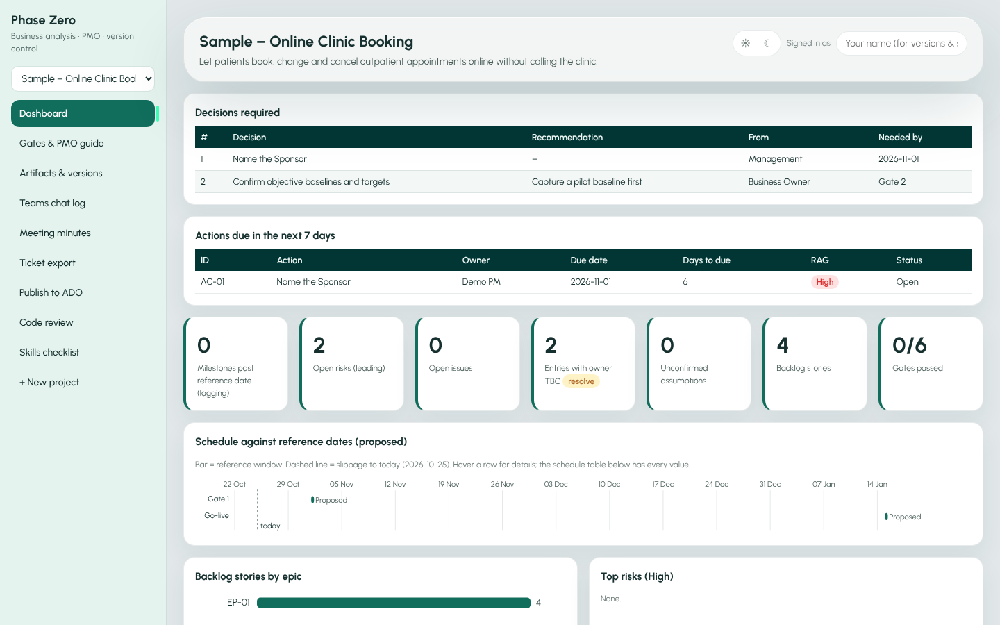 | 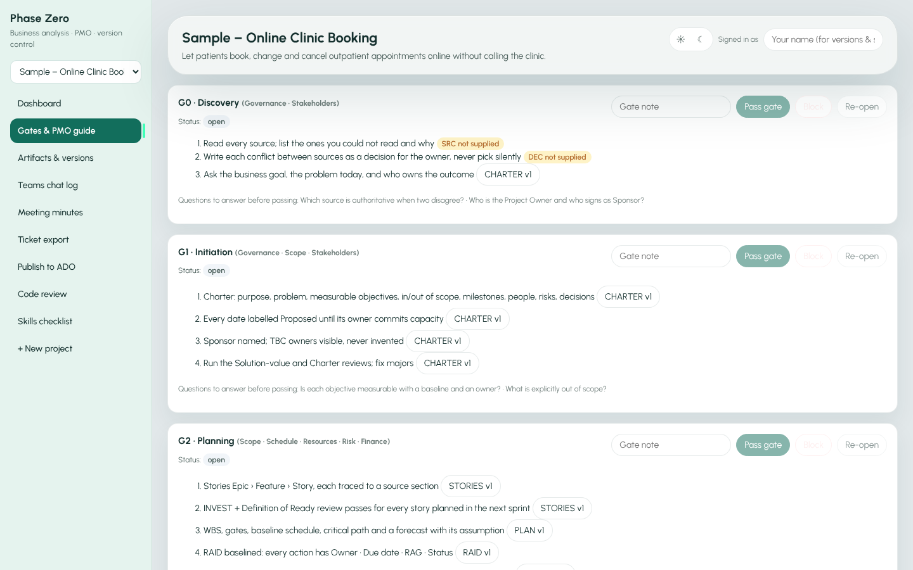 |
| **Artifacts and versions** | **Skills checklist** |
| 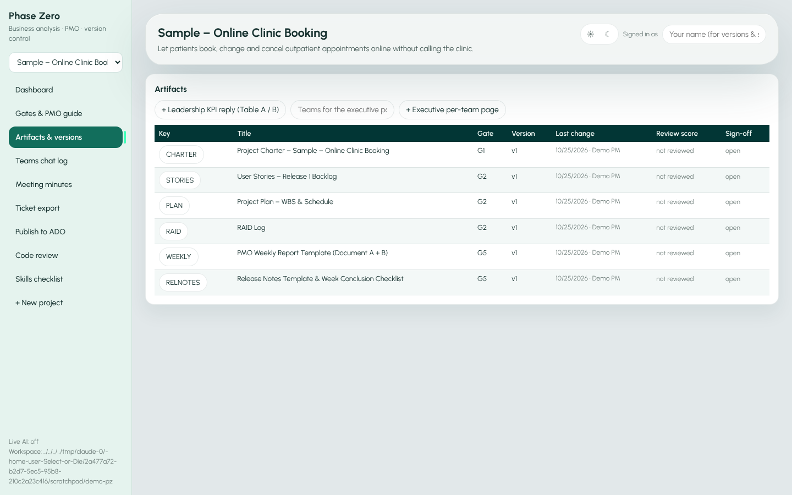 | 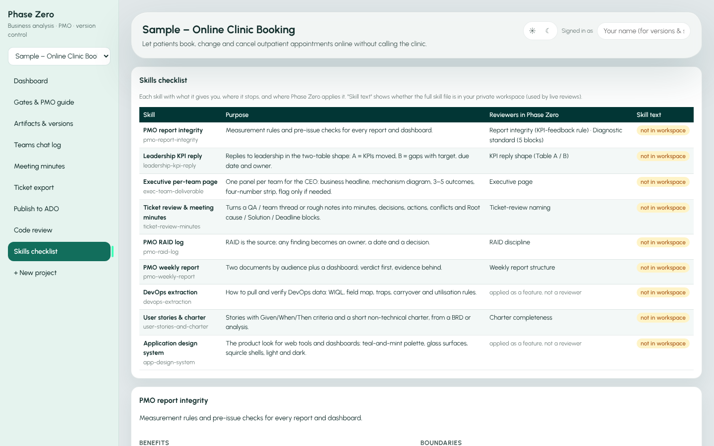 |

---

## 3. Minutes Desk

### 3.1 From a recording to issued minutes

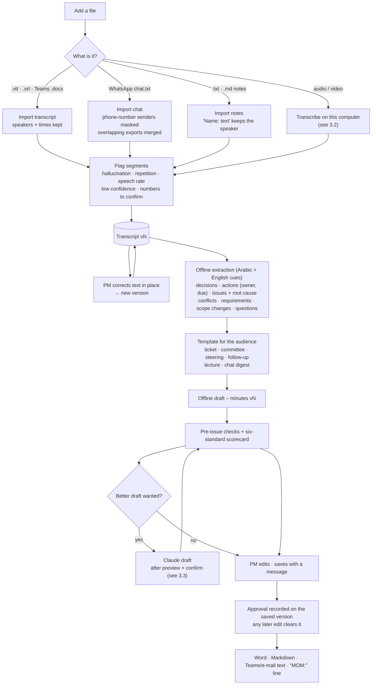

### 3.2 Speech recognition, step by step

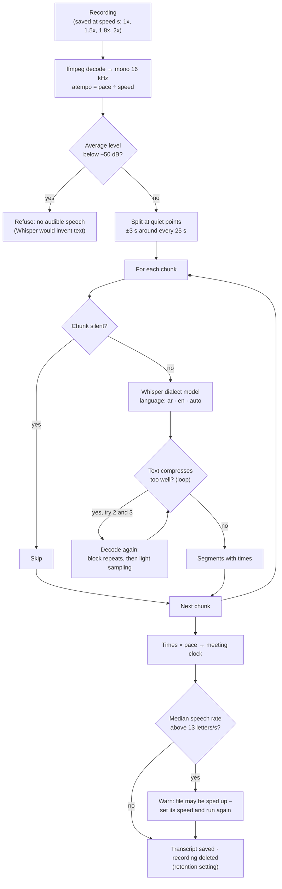

Engine choice: `whisper` (Hugging Face transformers, any OS, CPU or GPU) or `arabic-transcribe`
([ssagga/arabic-transcribe](https://github.com/ssagga/arabic-transcribe), when installed). The model comes
from the catalogue in `minutes_desk/config.py`. Each entry records the model card's licence, and a model with no
stated licence is marked ⚠. Fine-tunes saved by newer library versions fall back to their Whisper base's
tokenizer.

### 3.3 The Claude draft: preview, confirm, send

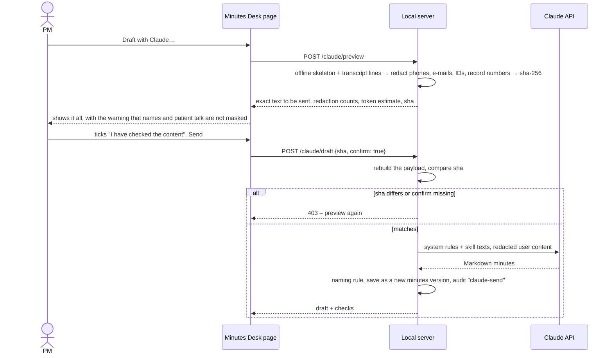

### 3.4 What the extractor recognises

| Item | Cues (English · Egyptian · Gulf · MSA, examples) | Rule |
|---|---|---|
| Decision | agreed, decided, approved · اتفقنا، قررنا، تم الاعتماد | Owner only when someone was named |
| Action | I will, please, needs to, follow up · لازم، مطلوب، هيعمل، هبعت · راح يسوي، بيسوي | Owner: attendee, @mention, "يا فلان", or the speaker for "I will / هبعت". Otherwise "TBC – requires assignment" |
| Due date | 30/10, tomorrow, next week, Thursday · بكرة، الأسبوع الجاي، يوم الخميس · باكر | Resolved against the meeting date, shown with what was said |
| Issue | issue, delay, blocker, error · مشكلة، واقف، متأخر، عطل | Root cause from the same sentence or one of the next two, else "Not established in the meeting" |
| Conflict | disagree, but the team says · مش موافق، بس التيم | Both sides recorded, neither chosen |
| Requirement | we need, should be able · عايزين، محتاجين، نبغى | Draft story "As a [role TBC], I want …, so that [value TBC]" |
| Scope change | new request, change request · طلب جديد، خارج النطاق | "Change request needed before work starts" |
| PMO note | My conclusion…, PMO: | Kept apart from what the meeting agreed |

### 3.5 Every template shares one spine

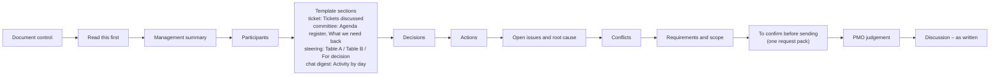

The six standards scored before issue:

1. Organisation and planning: every action has an owner, a date and a status.
2. Analysis: every issue has a root cause and a next action.
3. Business context: the meeting's objective or impact is named.
4. Information gathering: open questions are in one pack, grouped by who answers.
5. Report structure: the summary, decisions, actions, issues and requests are all present.
6. Terminology: house names are used, no vague timing, "baseline" only for an approved plan.

### 3.6 Modules

| Module | Responsibility |
|---|---|
| `__main__.py` | `serve`, `doctor`, `transcribe <file> [--speed --pace --language --model]` |
| `config.py` | Defaults merged with `workspace/config.json`; model catalogue with licences; model choice by device and dialect |
| `media.py` | ffmpeg probe and decode, speed/pace filter, loudness, quiet-point chunking (adapted from ssagga/arabic-transcribe, MIT) |
| `engines.py` | Doctor checks, engine choice, Whisper pipeline with loop retries, arabic-transcribe adapter, meeting-clock rescale, speed hint |
| `importers.py` | VTT/SRT, Teams .docx, WhatsApp (iOS and Android formats, merge, masked numbers), notes |
| `arabic.py` | Normalisation for matching (alef/ya/ta marbuta, diacritics, digits), direction detection |
| `governance.py` | Segment flags, redaction, naming rule, WER/CER |
| `extract.py` | Sentence split, cue matching, owners, due dates, root-cause attachment |
| `templates.py` | The spine and the seven templates (Markdown) |
| `checks.py` | Pre-issue findings and the six-standard scorecard |
| `claude_draft.py` | Prompt rules, skill texts, redacted payload with sha, streamed call with server-side fallback |
| `docx.py` | Markdown → Word in the document palette (RTL paragraphs, A4, header, page X of Y) |
| `store.py` | Meetings on disk, append-only versions, media retention, sign-off, audit log |
| `server.py` | HTTP layer, guards, routes, background transcription jobs, exports |
| `skills.py` | Which skills the tool applies, their benefits and boundaries |
| `web/` | The page: meetings, add recording, transcript editor, minutes editor with live preview, checks, Claude confirm, approval, exports, Pilot, Doctor, Skills, Audit |

### 3.7 API

| Method | Path | Purpose |
|---|---|---|
| GET | `/api/status`, `/api/doctor`, `/api/skills`, `/api/audit` | App state, machine check, skills, audit |
| GET, POST | `/api/meetings` | List or create a meeting |
| GET | `/api/meetings/:id` | Meeting with versions and media |
| POST | `/api/meetings/:id/meta` | Change meeting details |
| POST | `/api/meetings/:id/upload?name=` | Raw upload: transcript files import at once; media is stored |
| POST | `/api/meetings/:id/transcribe` | Start a job `{engine, model, speed, pace, language}` |
| GET | `/api/jobs/:id` | Job progress |
| GET, POST | `/api/meetings/:id/transcript` | Read, or save corrections as a new version |
| POST | `/api/meetings/:id/minutes/offline` | Offline draft for a template |
| GET, POST | `/api/meetings/:id/minutes` | Read, or save (message required) |
| POST | `/api/meetings/:id/claude/preview`, `/claude/draft` | Preview, then confirmed draft |
| POST | `/api/meetings/:id/signoff` | Record approval of the saved version |
| GET | `/api/meetings/:id/export?format=docx\|md\|txt\|mom` | Exports |
| POST | `/api/meetings/:id/media/delete`, `/api/wer` | Delete recording; Pilot WER/CER |

All writes need the header `X-Minutes-Desk: 1`.

### 3.8 Screens (invented sample meeting, `minutes-desk/demo/sample-ticket-review.vtt`)

| New meeting | Transcript with flags |
|---|---|
| 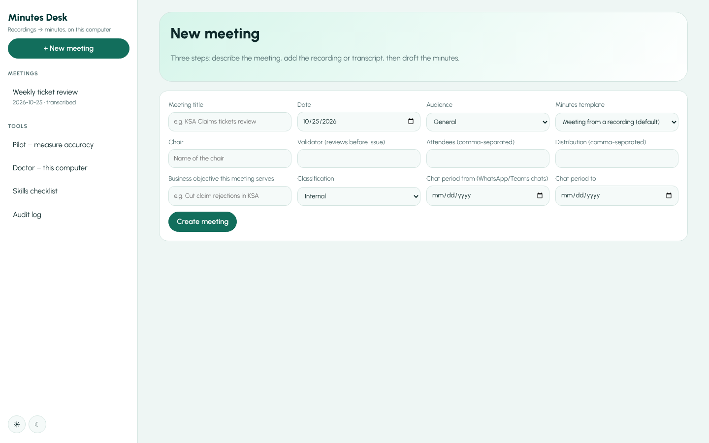 | 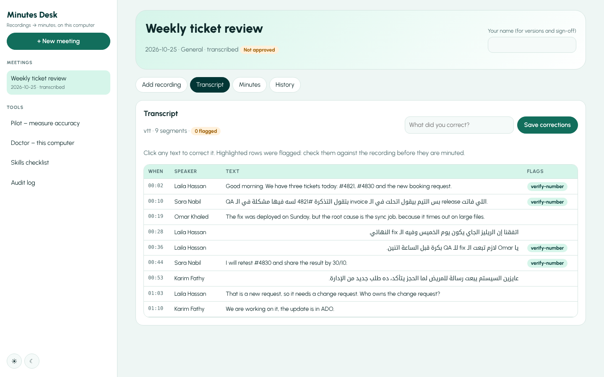 |
| **Pre-issue checks and scorecard** | **Claude draft: preview and confirm** |
| 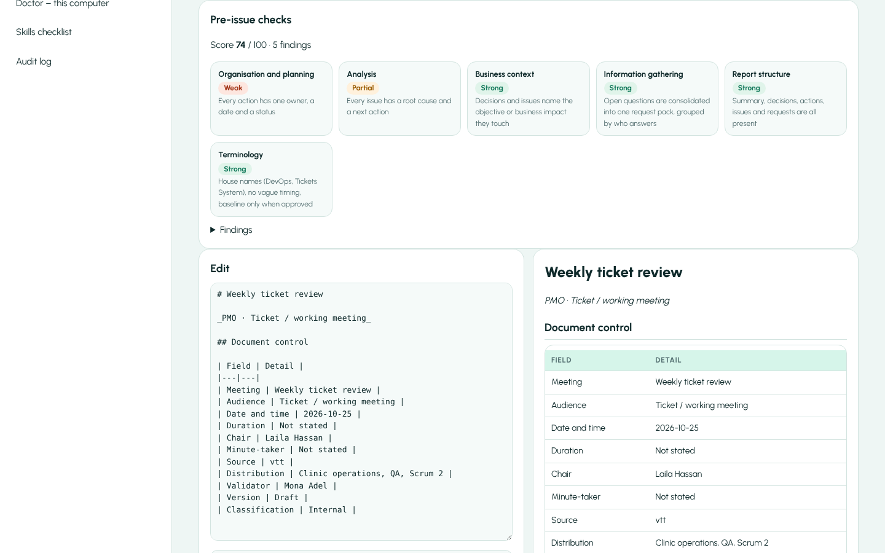 | 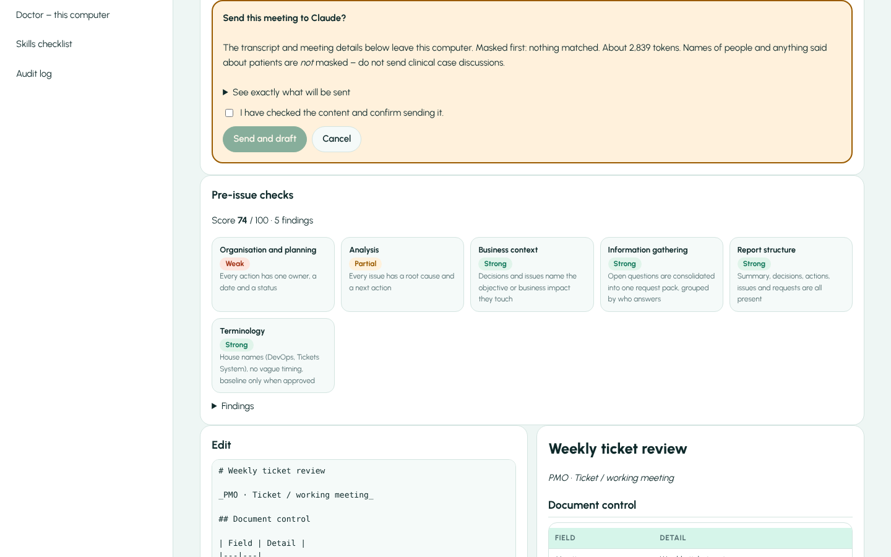 |
| **Minutes preview** | **Dark theme** |
| 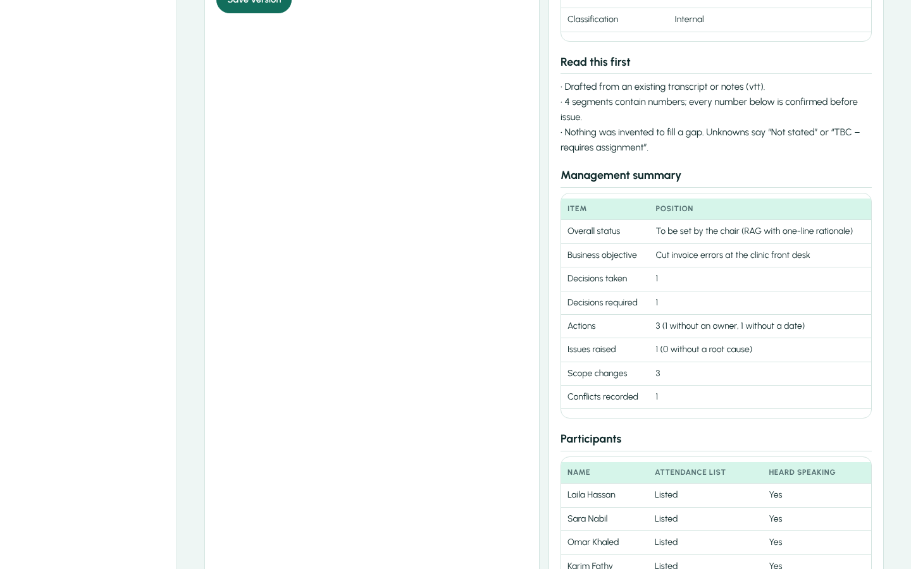 | 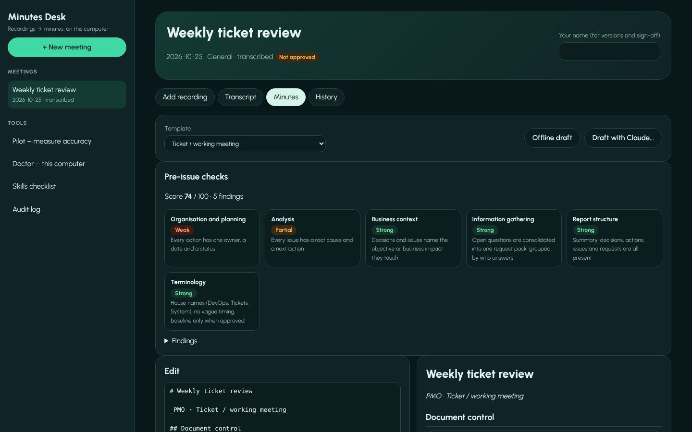 |

To try it: create a meeting, drop `demo/sample-ticket-review.vtt`, open **Minutes**, choose "Ticket / working
meeting", then **Offline draft**.

---

## 4. Skills: how the PMO rules are built into the code

The tools were built from a set of Claude skills (SKILL.md files). The skill texts are private and live in
`workspace/skills/`; the code carries only the rules. Each tool's **Skills checklist** screen lists each
skill's benefits, its boundaries and where it is coded.

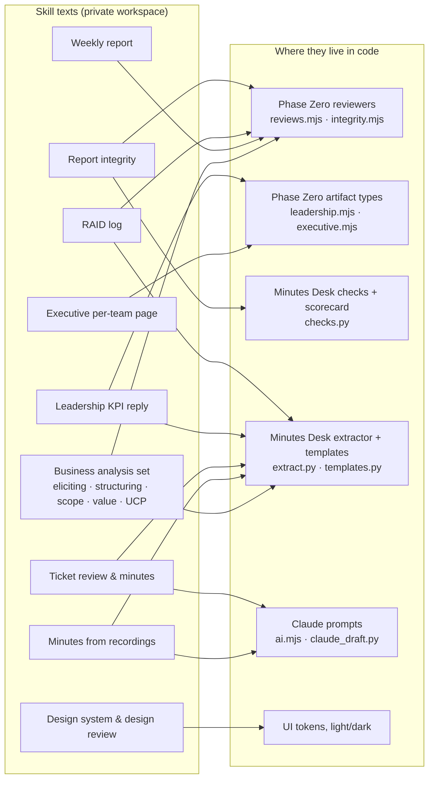

Conflicts between skills and project decisions were settled in favour of the stricter rule, and recorded:

- Skills that pre-authorised writing to Azure DevOps are overridden. Writes need the PM's exact approval phrase.
- "The wiki is empty" was outdated. The wiki git repository holds the pages; only the listing API returns none.
- "Baseline" is reserved for an approved, change-controlled plan.
- The application palette (teal and mint) and the document palette (navy and orange, no green) never mix.

---

## 5. Privacy and security model

| Concern | Phase Zero | Minutes Desk |
|---|---|---|
| Network exposure | Binds to `127.0.0.1` | Binds to `127.0.0.1` |
| DNS rebinding | Non-local `Host` → 421 | Non-local `Host` → 421 |
| Cross-site writes | `X-Phase-Zero: 1` required | `X-Minutes-Desk: 1` required |
| Static files | Confined to `web/dist` | Confined to `web/` |
| Request size | JSON 5 MB | JSON 20 MB; uploads up to the configured limit, streamed to disk |
| Data leaving the computer | Live review after confirm; e-mails and long numbers masked | Claude draft after preview + confirm + sha match; phones, e-mails, national IDs/Iqama, record numbers masked |
| Azure DevOps | Manifest to `outbox/` after the exact phrase | Never; a "MOM:" line to paste |
| Organisation content | `workspace/` git-ignored | `workspace/` git-ignored; recordings deleted after transcription |
| Traceability | Audit log of every save, review, gate, approval, export | Audit log of upload, transcription, Claude send, save, approval, export, deletion |

---

## 6. Quality: tests, measurements and checks

```bash
cd phase-zero   && npm test                               # 30 tests (node:test)
cd minutes-desk && python -m unittest discover -s tests   # 30 tests (standard library)
```

Both suites cover:

- version control and approvals;
- exports, opened and checked as valid files;
- the security guards (Host header, write header, static-path escape);
- every skill rule;
- the Arabic and English extraction;
- a function-size gate, which fails the build when a function grows past 60 lines or 12 branches.

**Measured speech-recognition accuracy** (2.5 minutes of public Egyptian Arabic speech, 4-core CPU):

| Model | Setting | Word error rate |
|---|---|---|
| Medium mixed-dialect | normal | **41.9%** |
| Medium mixed-dialect | pace 0.8x | 44.1% |
| Medium mixed-dialect | 2x file, restored | 70.3% |
| Small Egyptian | normal | 58.7% (71.4% before the loop fix) |
| Small Egyptian | 2x file, not restored | 81.3%, times at half the meeting clock |

The full table and what it means are in [`minutes-desk/README.md`](../minutes-desk/README.md#measured-accuracy).

---

## 7. Change log

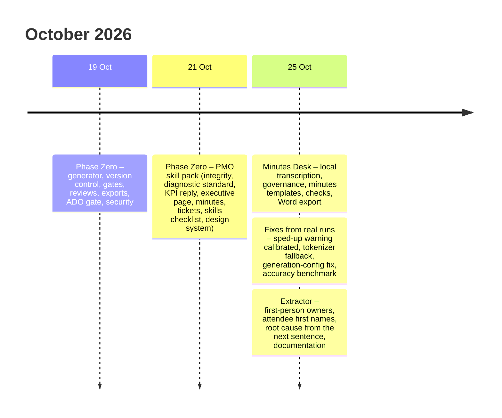

| Commit | Date | Change |
|---|---|---|
| `c1a0286` | 19 Oct | Add Phase Zero: local-first BA/PMO workspace with version control and skill reviews |
| `eae9d0b` | 21 Oct | Phase Zero: code the PMO skill pack into reviews, artifacts and tools |
| `a3dd522` | 25 Oct | Add Minutes Desk: local recordings-to-minutes tool for Arabic/English meetings |
| `6740f51` | 25 Oct | Calibrate the sped-up warning from measured rates; add tokenizer dependencies |
| `7a6b47a` | 25 Oct | Load a fine-tune's tokenizer from its Whisper base when its own fails |
| `87d5e52` | 25 Oct | Accept generation configs saved by newer transformers releases |
| `cca08ce` | 25 Oct | README: measured accuracy for speed, pace and model choice |
| this commit | 25 Oct | Extractor improvements, house RAG convention restored, documentation with flowcharts and screenshots |

Earlier commits (2014) are the original Select or Die jQuery plugin.
